# BLACK ICE · 白夜站

**A playable first-person shooter built from code — one self-contained HTML file.**

Procedural arctic outpost. Raw WebGL2. Four hostile roles, a boss, a full shell, touch controls.
No external assets, no dependencies, no tracking.

[**▶ Play the game**](https://norwinyu.github.io/black-ice/) · [**Screenshots & build process**](https://norwinyu.github.io/black-ice/process.html) · [**Deploy**](DEPLOY.md) · [**Source**](docs/index.html)

`8 / 8 gates` · `163 draw calls` · `127k tris` · `12 lights` · `318 KB` · `0 dependencies`

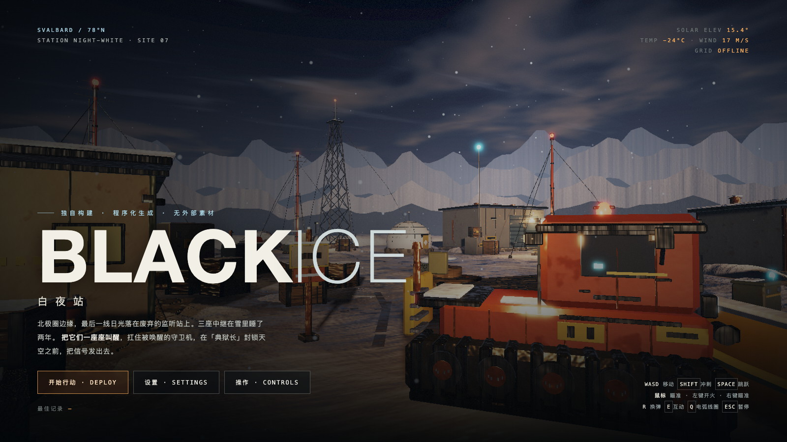

> The last listening post at the edge of the Arctic Circle has gone quiet.
> Wake three relay towers, hold the yard against the station's own guard machines,
> and bring down **Warden Prime** before it seals the sky.

**Contents:** [Play](#play) · [Screenshots](#screenshots) · [What's inside](#whats-inside) · [Under the hood](#under-the-hood) · [Build & verify](#build--verify) · [How it was made](#how-it-was-made) · [Deploy](#deploy) · [Privacy](#privacy)

---

## Play

The game is a **single HTML file**. There is no install, no package manager, no runtime download,
no server-side code, and no network request while playing.

- **Live build:** [norwinyu.github.io/black-ice](https://norwinyu.github.io/black-ice/)
- **Feature gallery, iteration record & verification:** [process.html](https://norwinyu.github.io/black-ice/process.html)
- **Source build:** [`docs/index.html`](docs/index.html) (identical to the root [`game.html`](game.html))

Run locally:

```bash
python3 -m http.server 8000
# open http://localhost:8000/game.html
```

Opening `game.html` directly also works; a local server is recommended for pointer lock.
Click **DEPLOY** to start; `Esc` pauses at any time.

### Controls

| Input | Action |
|---|---|
| `WASD` | Move |
| `Shift` / `Space` | Sprint / jump |
| Mouse | Look; **LMB** fire; **RMB** aim down sights |
| `R` | Reload |
| `E` | Interact (relay, supply) |
| `Q` / `1` / `2` | Switch tool (AR-9 / ARC-9) |
| `Esc` / `M` | Pause / mute |
| Touch | Left stick, right-drag look, fire / aim / reload / interact / jump / swap |

A run is about **6–10 minutes**. Cross the yard, wake three relays, survive the response,
then break the Warden's three exposed emitters. Best score and settings persist in
`localStorage`; there is no mid-run save.

---

## Screenshots

All stills are from the shipped build, at the skill's fixed cameras or the feature demo poses.
No mockups, no concept art. The full 25-image set is in the
[process page](https://norwinyu.github.io/black-ice/process.html).

### The objective is a place

<table>
<tr>
<td width="50%"><a href="docs/shots/relay.jpg">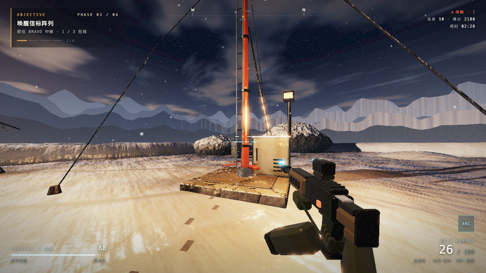</a></td>
<td width="50%"><a href="docs/shots/gameplay.jpg">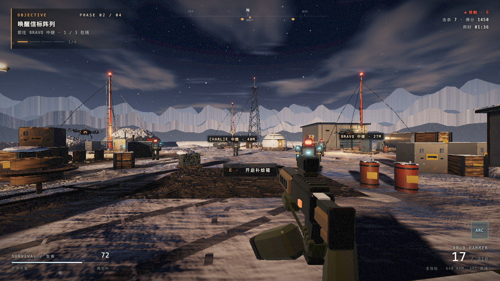</a></td>
</tr>
<tr>
<td><sub><b>Relays are physical places.</b> Walk up, press E: the beacon turns from red to a cyan ring, the HUD step advances, a wave is queued. Nothing teleports; the yard stays the same place.</sub></td>
<td><sub><b>HUD hierarchy.</b> Objective → survival → weapon. Objective card, compass, world markers, health, ammo, tool state, prompt and subtitles. The nearest interactable names its key; nothing out of range does.</sub></td>
</tr>
</table>

### Two tools, two answers

<table>
<tr>
<td width="50%"><a href="docs/shots/firefight.jpg">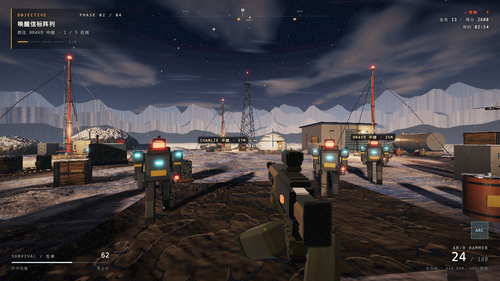</a></td>
<td width="50%"><a href="docs/shots/arc.jpg">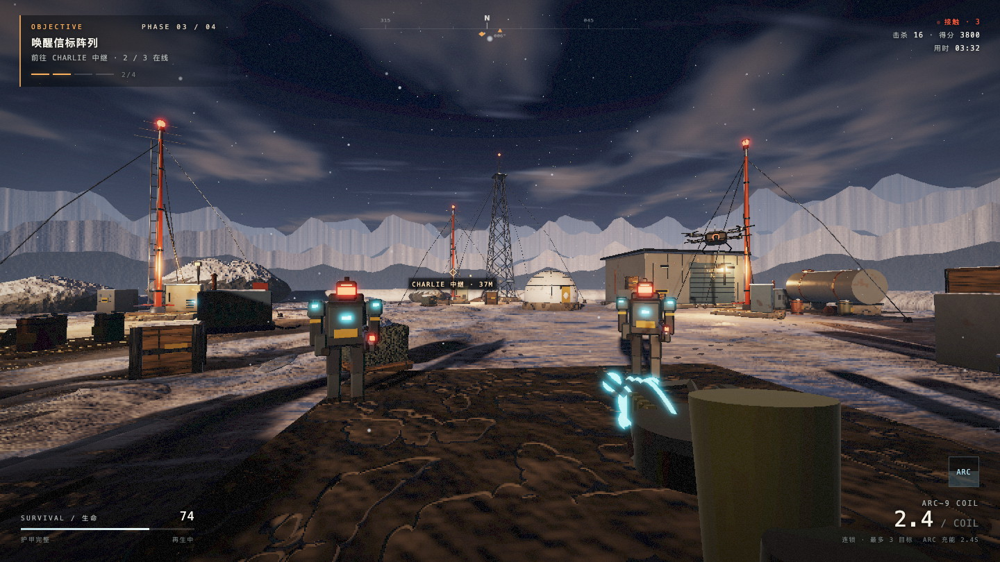</a></td>
</tr>
<tr>
<td><sub><b>AR-9 HAMMER · primary.</b> Hitscan, 640 RPM, 30-round magazine, ADS, recoil kick, moving spread, headshot multiplier, hit markers and decals. Reload and empty states are audible and visible.</sub></td>
<td><sub><b>ARC-9 COIL · secondary.</b> Chains to up to three targets in a cone, damage falls off along the chain, five-second cooldown shown as a dial and a number. It is the answer to the Heavy's shield.</sub></td>
</tr>
</table>

### Four hostile roles, one climax

<table>
<tr>
<td width="50%"><a href="docs/shots/roster.jpg">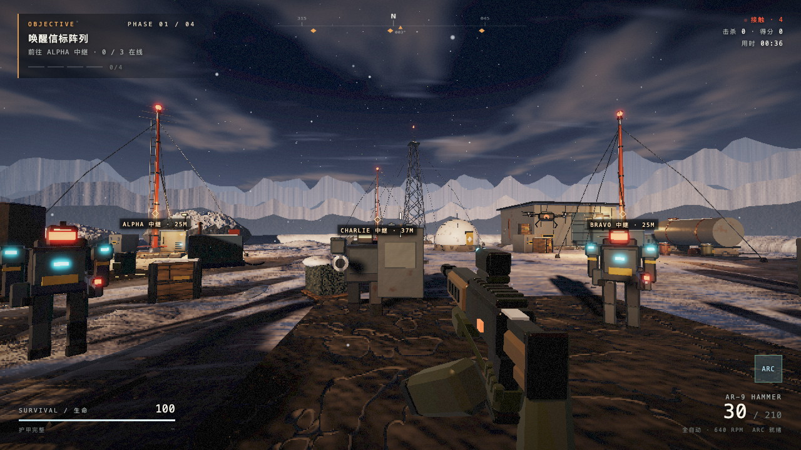</a></td>
<td width="50%"><a href="docs/shots/boss.jpg">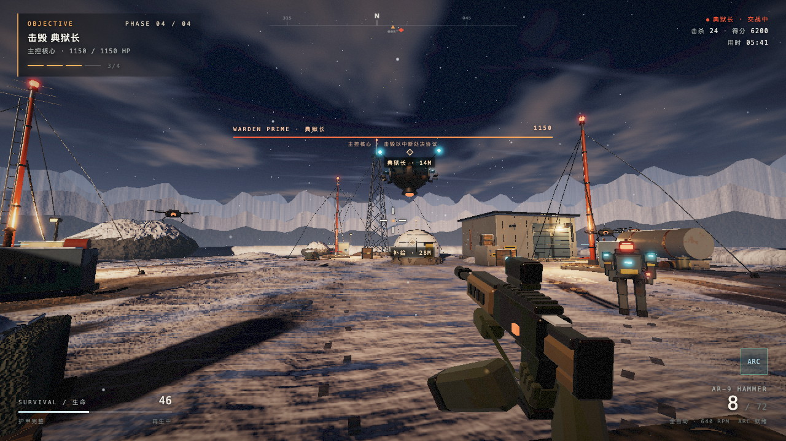</a></td>
</tr>
<tr>
<td><sub><b>RAIDER · WASP · HEAVY.</b> Raiders advance, strafe and fire telegraphed bursts. Wasps hover, orbit and throw dodgeable plasma. Heavies carry a shield that softens frontal fire and fire a five-shot spread.</sub></td>
<td><sub><b>WARDEN PRIME.</b> A hovering core ringed by armour plates, three exposed emitters, a radial plasma burst, summoned Wasps and a dedicated boss bar. Kill it and the extraction timer starts.</sub></td>
</tr>
</table>

### Pressure, recovery, and a named death

<a href="docs/shots/survival.jpg">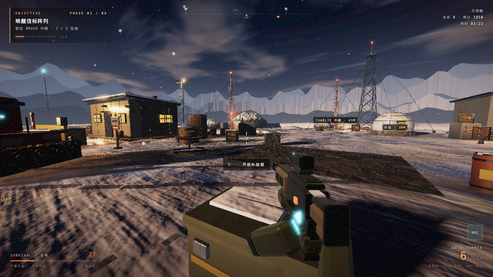</a>

<sub><b>At 27 HP:</b> the damage direction arrow, the low-health vignette, a finite magazine, and a supply crate that refills reserve ammo and restores health. Death does not say “you died”; it names the attacker and the weapon on the end screen.</sub>

### The shell is part of the game

<table>
<tr>
<td width="25%"><a href="docs/shots/pause.jpg">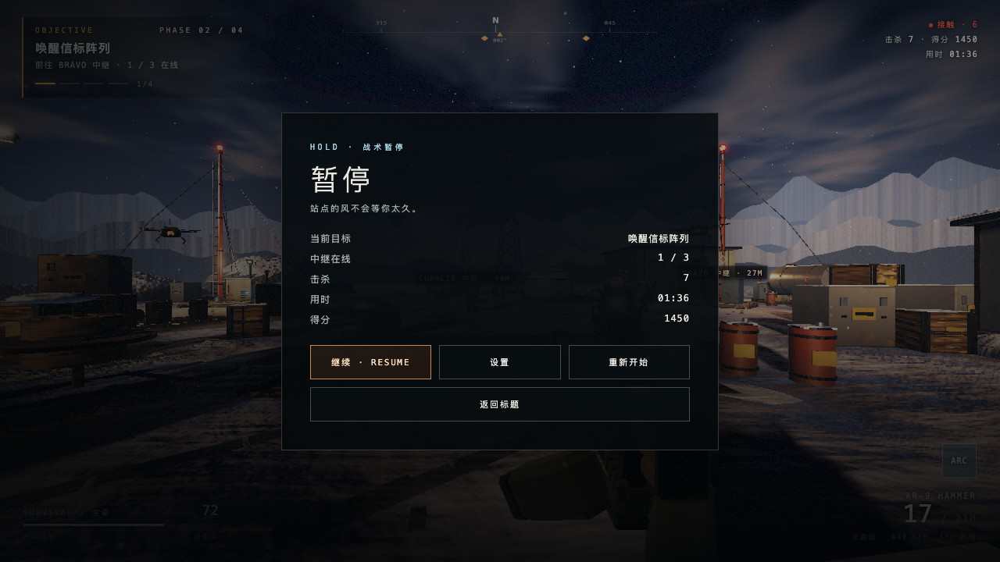</a></td>
<td width="25%"><a href="docs/shots/settings.jpg">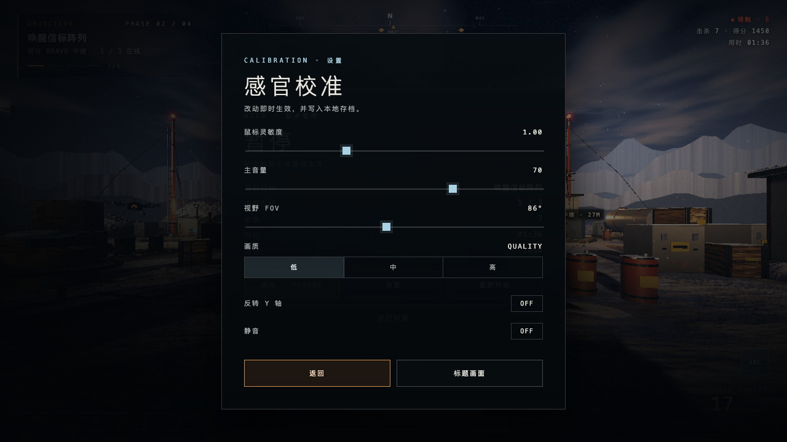</a></td>
<td width="25%"><a href="docs/shots/lost.jpg">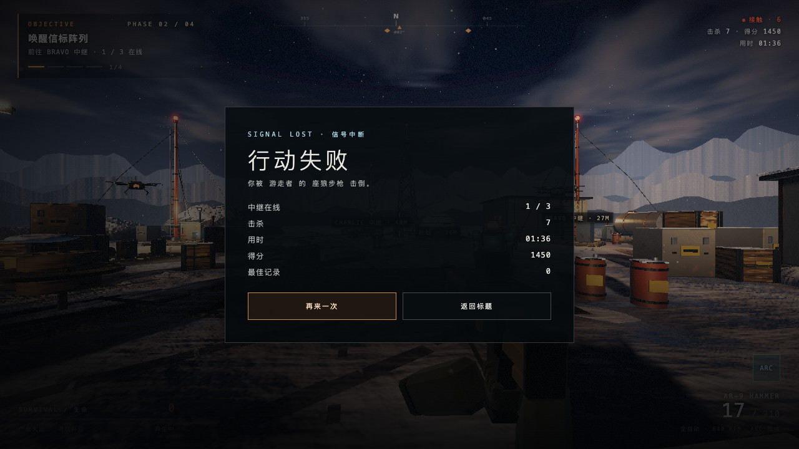</a></td>
<td width="25%"><a href="docs/shots/won.jpg">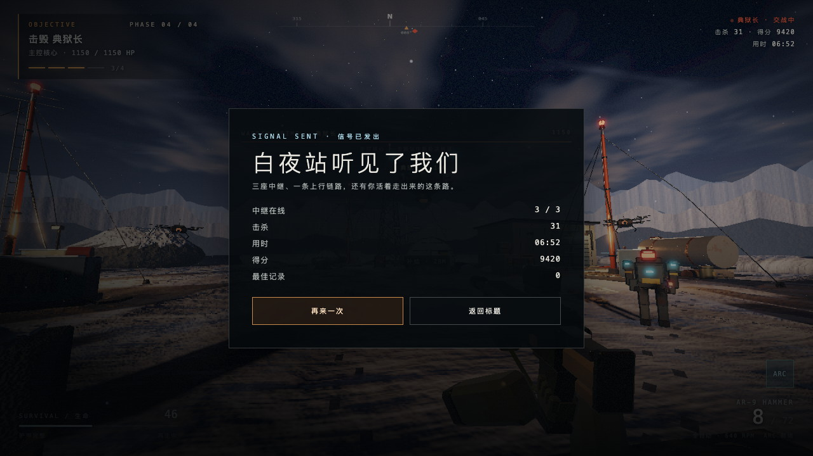</a></td>
</tr>
<tr>
<td><sub><b>Pause</b><br>Run stats; resume, settings, restart, menu.</sub></td>
<td><sub><b>Settings</b><br>Sensitivity, volume, FOV, invert-Y, quality, mute; persisted.</sub></td>
<td><sub><b>Failure</b><br>“You were cut down by a Raider's wolf rifle.”</sub></td>
<td><sub><b>Victory</b><br>Relays, kills, time, score, best.</sub></td>
</tr>
</table>

### World & image formation

<table>
<tr>
<td width="33%"><a href="docs/shots/hero.jpg">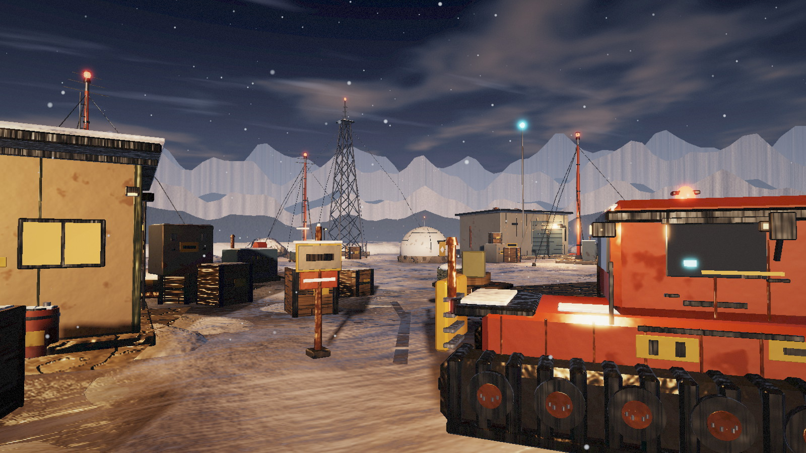</a></td>
<td width="33%"><a href="docs/shots/close.jpg">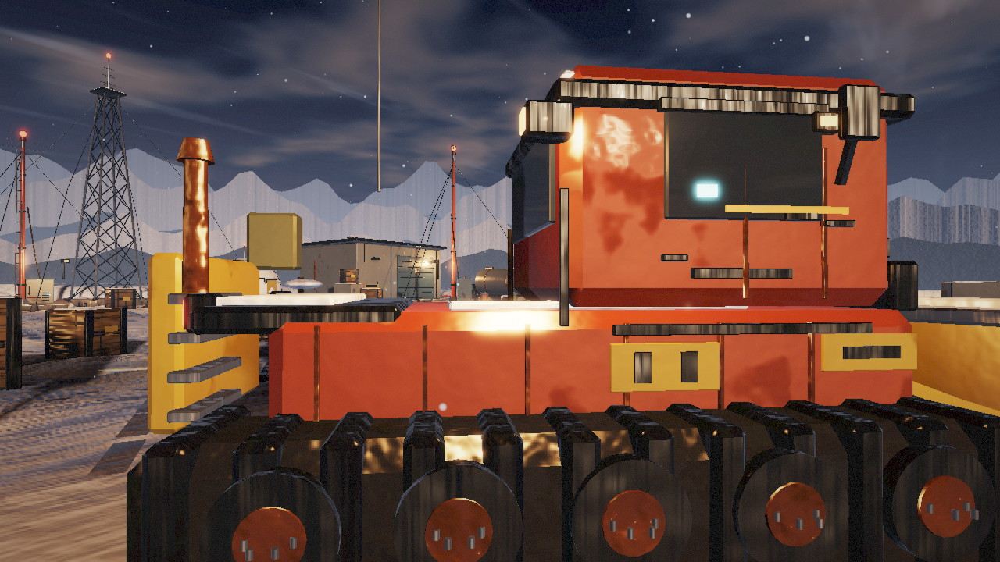</a></td>
<td width="33%"><a href="docs/shots/wide.jpg">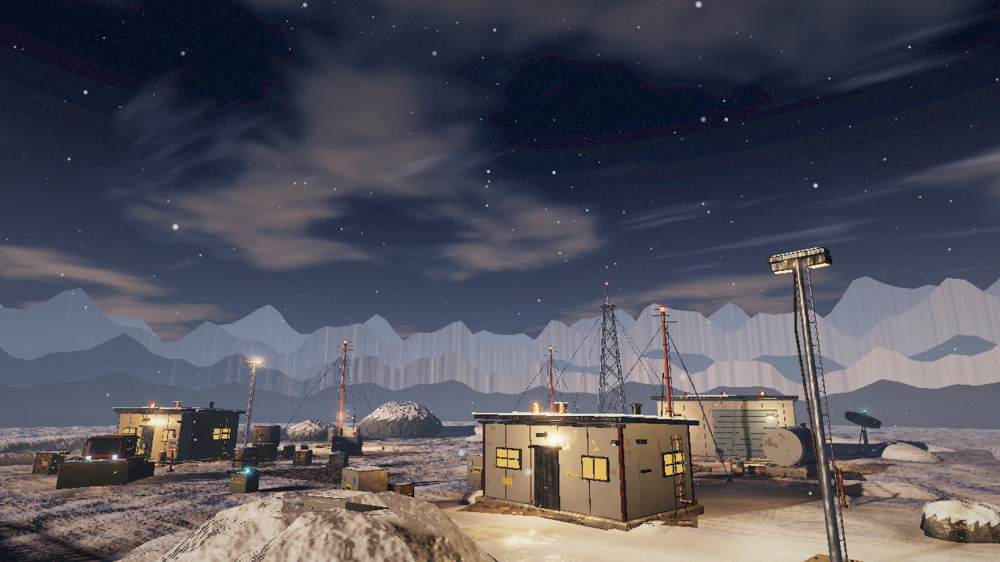</a></td>
</tr>
<tr>
<td><sub><b>HERO.</b> Low sun, long shadows; snowcat foreground, modules behind, 16 m mast and three ridge layers.</sub></td>
<td><sub><b>CLOSE · 3 m.</b> Chamfered edges, snow caps, grime, door seams, instrument glow, track plates.</sub></td>
<td><sub><b>WIDE.</b> Sky structure, horizon haze, ridge silhouette; warm practicals against cold fill.</sub></td>
</tr>
</table>

### Touch, at 390 × 844

<table>
<tr>
<td width="30%"><a href="docs/shots/mobile.jpg">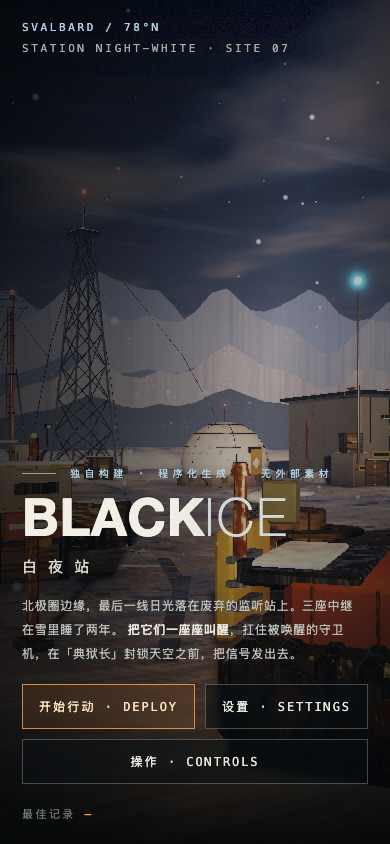</a></td>
<td width="30%"><a href="docs/shots/mobile-gameplay.jpg">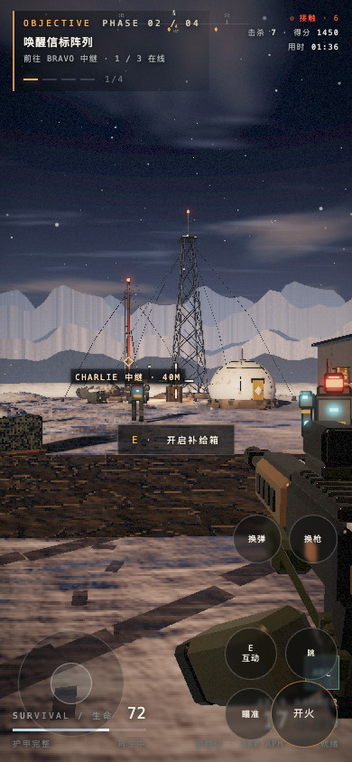</a></td>
<td width="40%" valign="top"><sub><b>Same game, no hover dependency.</b> The mobile gate checks a 390×844 viewport, no horizontal overflow, and the touch UI. Left stick; right-drag look; fire, aim, reload, interact, jump and swap buttons. It is playable, though the narrow-screen HUD and the viewmodel do crowd the right-hand buttons.</sub></td>
</tr>
</table>

---

## What's inside

| | |
|---|---|
| **Premise** | A failing arctic listening post; three relays; a machine warden sealing the sky. |
| **Objective chain** | ALPHA relay → BRAVO relay → CHARLIE relay → destroy Warden Prime. Three physical towers; each one spawns a response. |
| **Hostiles** | Raider (rifle, burst), Wasp (hover drone, plasma), Heavy (shield + shotgun spread), Warden Prime (boss). |
| **Tools** | AR-9 rifle + ARC-9 arc coil; reload, ADS, recoil, switching, cooldown. |
| **Player verbs** | Move, sprint, jump, look, aim, fire, reload, switch, interact. |
| **World** | Three relay masts, a garage and workshop, huts, a radome, a fuel depot, a 16 m comms mast, a snowcat, perimeter drifts, three mountain layers. |
| **Shell** | Title, settings, pause, help, save, failure, victory, touch controls. |
| **Audio** | 17 synthesized WebAudio events plus a generated wind bed; master mute. |
| **Persistence** | Best score and settings in `localStorage` (`blackice.best`, `blackice.settings`). |
| **Session** | 6–10 minutes; fail, retry, win; no mid-run save. |
| **Constraints** | One HTML file; no external models, textures, audio, fonts or reference frames; no network requests. |

### The loop

1. **Read the yard.** Compass bearings, world markers, enemy glows and the objective card.
2. **Choose a fight.** Rifle for range and precision; arc coil for shields and clusters.
3. **Wake a relay.** Hold `E`; the beacon answers; the station sends a wave.
4. **Survive the response.** Break line of sight, use supply crates, watch the heavy's shield.
5. **Repeat ×3, then break the Warden.** Three emitters; radial bursts; summoned Wasps.
6. **Extract.** Win/lose screens, named cause, score, best.

---

## Under the hood

The renderer is **raw WebGL2 and GLSL ES 3.00** — no Three.js, no engine, no asset pipeline.

```
analytic dusk sky
  → baked static shadow map + per-frame dynamic shadow map
  → procedural PBR world (GGX / Smith / Schlick, analytic sky IBL)
  → additive FX (sparks, tracers, arc, snow, glows)
  → viewmodel pass (separate depth clear)
  → HDR RGBA16F
  → bright-pass + two-scale blur bloom
  → ACES tonemap + filmic S-curve
  → FXAA + grain + vignette
```

**Procedural solids.** A small geometry kit (`Builder`) makes chamfered boxes, cylinders,
ellipsoids and tubes with per-vertex colour, material and part IDs. Props carry a baked
contact shade, snow caps, grime and identity features. Surfaces use procedural shader
families: snow, rock, concrete, painted metal, rust, steel, wood, rubber, ice, emissive
white/red/cyan, fabric, glass and tar.

**Snow.** A 0.8 m height field gives wind ridges and sastrugi; a fragment shader adds
fine grain, boot prints, tyre ruts and a sparkle term. Snowfall is a camera-centred
particle field, not a skybox.

**Enemies.** Rigid-part rigs, one draw per unit, with 24 per-part matrices in a uniform.
Raiders, Wasps and Heavies share the rig and differ in torso, head, shield and weapon.
AI has line-of-sight checks, strafing, wind-up, hitscan and projectiles.

**Collision.** AABB colliders derived from placement data, a spatial hash, and per-axis
resolved movement. The page exposes `__TESTMOVE` for the collide gate; the playtest and
collision gates use the same movement code the player uses.

**HUD & audio.** DOM/CSS HUD with a canvas compass; prompts are recomputed from range and
facing. Audio is synthesized on the fly: weapons, impacts, relays, footsteps, wind,
boss cues. No samples.

**Performance.** 163 draw calls, 127,337 triangles, 12 lights in the shipped start state
(340 max calls / 900k max tris / 14 max lights). Quality presets trade render scale,
shadow resolution, snow count and bloom taps.

---

## Build & verify

The source is split into ordered modules and concatenated. There are no npm dependencies.

```bash
node build.mjs          # src/* -> game.html
cp game.html docs/index.html
```

The recorded acceptance run passed **8 / 8** gates:

| Gate | Result | What it proves |
|---|---|---|
| `shaders` | PASS | No compile/link errors; HDR, shadows, bloom and FXAA all live. |
| `census` | PASS | 150 meshes, 0 object-contract failures; close props have parts and identity. |
| `collide` | PASS | 0 penetrations, 0 out-of-bounds, 0 walk-through; boundary parity. |
| `lights` | PASS | Every point light sits on a modelled fixture; none float. |
| `playtest` | PASS | ALPHA → BRAVO → CHARLIE progress 1 → 2 → 3; lethal damage names a cause, shows the end screen, resets to 100 HP. |
| `product` | PASS | Title, settings, pause, save, lost, won, touch, objectives, roles, tools, cameras and budgets. |
| `mobile` | PASS | 390×844, no horizontal overflow, touch UI present. |
| `look` | PASS* | Tone + emptiness in the skill's declared fallback. |

**Final build re-check:** product / playtest / mobile PASS.
**Product readout:** 163 draw calls · 127,337 triangles · 12 lights.
**Look fallback:** hero 77.5% / close 75.2% / wide 72.0% midtones; flat tiles 3% / 0% / 7%;
clipped highlights ≤ 0.18%, clipped lows ≤ 0.56%.

\* Because the brief forbids reference material, no reference profile was captured.
The look gate runs in the skill's declared fallback mode (tone and emptiness), not as a
similarity score against another subject. The full log is in [`NOTES.md`](NOTES.md).

The gate harness comes from the **photoreal-game** skill and is **not redistributed** in
this repository. The commands and results are recorded in [`NOTES.md`](NOTES.md).

---

## How it was made

This project followed the **photoreal-game** skill: a procedure for building playable,
photorealistic 3D games from code. It is a procedure, not a template. The skill shaped:

- the **render-observable contract** — fixed cameras, seeded clock, `__READY`, `__STATS`,
  `__PRODUCT`, `?shot`, `?seed`;
- the **product-first order** — title, settings, pause, save, failure, victory, touch and a
  complete objective chain before the final grading pass;
- the **gates** — shaders, census, collision parity, light anchoring, playtest, product,
  mobile and look, each executable;
- the **one-lever-per-round loop** — change one thing, re-shoot the fixed cameras, keep the
  frames, revert regressions.

Eight rounds are recorded with their failures: the first nearly-black frame (shader
precision), the exploded snowcat (unbalanced transform stack), the key light behind the
facades, the flat-tile snow, the oversized viewmodel, and two real bugs found by the
product/playtest pass (boss win scheduling, a bad global edit in `startGame`).
The late feature-still pass then exposed a third: ribbon tracers at point-blank range
became screen-filling triangles. They were replaced with additive sprite streaks; the
diagnostic frames are documented but deliberately excluded from the gallery.

<table>
<tr>
<td width="33%"><a href="docs/shots/iter-00.jpg">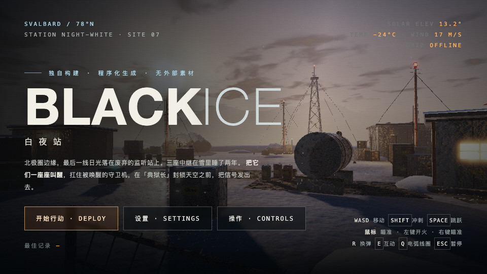</a></td>
<td width="33%"><a href="docs/shots/iter-02.jpg">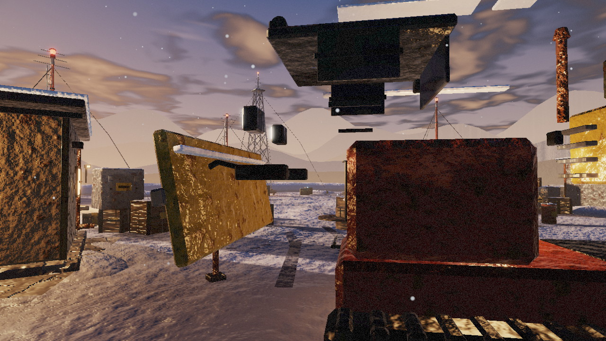</a></td>
<td width="33%"><a href="docs/shots/iter-06.jpg">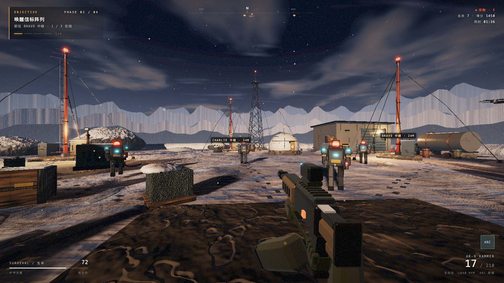</a></td>
</tr>
<tr>
<td><sub><b>Round 00.</b> Shadow sampler precision and a missing FXAA include: both programs failed. The scene appeared after the fix.</sub></td>
<td><sub><b>Round 02.</b> Unbalanced <code>at()</code> transforms exploded the snowcat. Rewritten with a balanced <code>rbox()</code> helper.</sub></td>
<td><sub><b>Round 06.</b> Cyan/red enemy lamps and grading made hostiles readable at range and reached the tone band.</sub></td>
</tr>
</table>

The complete eight-round timeline, all 25 feature stills, the verification table and the
skill notes are on the **[process page](https://norwinyu.github.io/black-ice/process.html)**.

---

## Repository layout

```
game.html            playable single-file build (root)
src/                 original source: engine, world, props, shaders, enemies, game, UI
build.mjs            src/* -> game.html
docs/index.html      the same game, served by GitHub Pages
docs/process.html    feature gallery + 8-round iteration record + verification + skill
docs/shots/          optimized JPEG stills used by the README and the site
docs/.nojekyll       serve the folder as-is
NOTES.md             art brief, build log, gate evidence, known limits
README.md            this file
DEPLOY.md            GitHub Pages steps
```

`/shots/` (raw captures), `/tools/` (skill harness) and `/refs/` are local-only and
excluded by `.gitignore`. The public site contains only the game, the process page and
the optimized stills.

---

## Deploy

GitHub Pages serves the **`docs/`** folder directly. No build step is required on the host.

1. **Settings → Pages → Build and deployment**
2. **Source:** Deploy from a branch
3. **Branch:** `main` · **Folder:** `/docs`
4. Save. After ~1 minute:

- **https://norwinyu.github.io/black-ice/**
- **https://norwinyu.github.io/black-ice/process.html**

Step-by-step commands and troubleshooting are in [`DEPLOY.md`](DEPLOY.md).
The site is static; there is no server, no database and no analytics.

---

## Privacy

No analytics, cookies, accounts, tracking pixels, external fonts or third-party requests.
The game writes only `blackice.best` and `blackice.settings` to the browser's local
storage. The site is static; nothing is sent to a server.

The repository contains no real name, private email, address or token. The site is
published from the owner's public GitHub account; the screenshots were re-encoded to strip
metadata. See [`docs/process.html`](https://norwinyu.github.io/black-ice/process.html) for the
same statement on the site.

## Known limits

- Enemies are rigid-part rigs, not skinned meshes: readable at combat range, robotic up close.
- Audio is synthesized, not recorded.
- The 390×844 HUD and viewmodel crowd the right-hand touch buttons; playable but tight.
- No mid-run save; only best score and settings persist.
- Headless stills were rendered with SwiftShader; real-GPU frame rate was not measured.
- The look gate is the declared fallback, not a photographic similarity score.

## Credits

Original code, procedural art, world, UI and synthesized audio were produced for this
project. The **photoreal-game** skill supplied the procedure and gate design. Its harness
is credited but **not redistributed** here. No reference material or external asset was
used. AI-assisted implementation; all in-repo content is original to this project.
